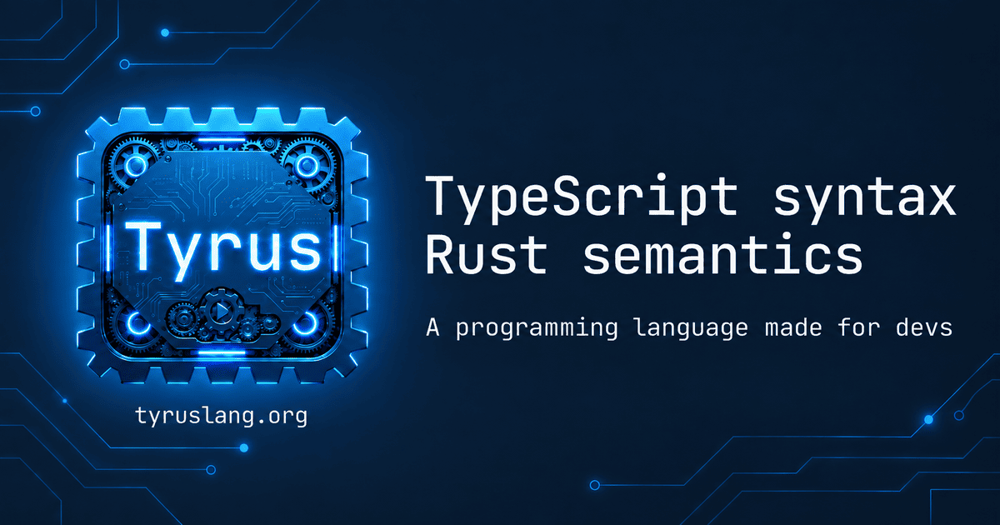

# Tyrus

**TypeScript syntax. Rust semantics.**



Tyrus is a native programming language with concise syntax and ownership and borrowing checks.

## Getting Started

Install Tyrus on macOS, Linux, or WSL:

```sh
curl -fsSL https://tyruslang.org/install.sh | sh
```

On Windows, run this in PowerShell:

```powershell
irm https://tyruslang.org/install.ps1 | iex
```

Create a project with the interactive CLI:

```sh
tyrus new
```

The CLI asks for the project name and target, then scaffolds the project from your answers.

Build artifacts go to `target/debug/` by default and `target/release/` with `tyrus build --release`. `tyrus dev` uses `target/debug/`.

The tag-triggered native release workflow is configured for Linux x86_64, macOS Apple Silicon, and Windows x86_64. It packages the CLI, native runtime, and matching LLVM tools after each platform's build and smoke checks pass.

Visit the [LSP editor support guide](https://tyruslang.org/tooling/lsp) to choose support for VS Code, Neovim, Zed, IntelliJ, or Kate. Install the [Tyrus extension from the VS Code Marketplace](https://marketplace.visualstudio.com/items?itemName=tyrus-lang.tyrus).

## Documentation

- [https://tyruslang.org](https://tyruslang.org)

## Playground

- [https://playground.tyruslang.org](https://playground.tyruslang.org)

## Contributing

See [CONTRIBUTING.md](CONTRIBUTING.md) for contribution guidelines.

## License

See [LICENSE](LICENSE) for the license terms.
